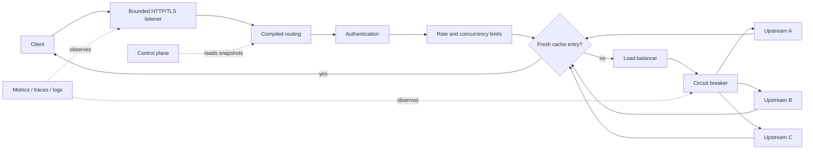

# Relay

[](https://github.com/AntoniRom17/relay/actions/workflows/ci.yml)
[](https://github.com/AntoniRom17/relay/actions/workflows/security.yml)

Relay is a production-minded API gateway and reverse proxy written in Rust. Its data plane uses
Hyper and Tokio directly for streaming HTTP/1.1, HTTP/2, and gRPC-compatible traffic; its small
Axum control plane exposes health, readiness, metrics, and secret-redacted runtime state.

Relay is designed for high-throughput asynchronous proxying, but it makes no unsupported
throughput claims. Reproducible microbenchmark commands and machine-specific baselines live in
[the performance guide](docs/performance/benchmarks.md).

## Capabilities

- Streaming request and response forwarding with pooled HTTP and HTTPS upstream connections
- Host, exact-path, prefix, method, and header routing with deterministic precedence
- Round-robin, weighted round-robin, and least-connections scheduling
- Active health checks, passive failure tracking, bounded retries, and a closed/open/half-open
  circuit breaker
- Local sharded and Redis/Lua distributed token-bucket rate limiting
- Constant-time SHA-256 API-key matching and asymmetric RS256, ES256, or EdDSA JWT validation
- Rustls termination with HTTP/2 ALPN and atomically replaceable certificate state
- Route, pool, listener, and cache concurrency or memory bounds with fail-fast load shedding
- Prometheus metrics, structured logs, request IDs, OTLP span export, and W3C trace propagation
- Atomic watched-file reload for routes, pools, policies, and authentication material
- A separate, secret-redacted control plane with `/health`, `/ready`, and `/metrics`
- A conservative route cache for complete, public GET/HEAD responses

## Architecture



Every request holds one immutable runtime snapshot and bounded RAII permits until its response body
is finished or dropped. A reload builds and validates a replacement before one `ArcSwap`; existing
streams continue safely on their old snapshot. See [architecture overview](docs/architecture/overview.md)
and [request lifecycle](docs/architecture/request-lifecycle.md).

## Quick start

Requirements: Rust 1.88+ and the platform's native C/C++ build tools (required by the rustls crypto
provider).

```console
cargo build --workspace
cargo run -p relay-demo -- --listen 127.0.0.1:9001 --name upstream-a
```

In another terminal:

```console
cargo run --bin relay -- run --config configs/basic.yaml
curl http://127.0.0.1:8080/hello?from=relay
curl http://127.0.0.1:9090/metrics
```

The upstream response identifies the selected backend and echoes the method, URI, body, request ID,
and trace context. Edit `configs/basic.yaml`; Relay checks the file every two seconds and atomically
installs compatible changes.

To demonstrate weighted balancing and retries, run two upstreams and use the matching profile:

```console
cargo run -p relay-demo -- --listen 127.0.0.1:9001 --name app-a --fail-every 3
cargo run -p relay-demo -- --listen 127.0.0.1:9002 --name app-b
cargo run --bin relay -- run --config configs/load-balanced.yaml
```

## Configuration and CLI

Configuration is a deny-unknown-fields YAML API with aggregated semantic errors. Examples progress
from [basic](configs/basic.yaml) through [load-balanced](configs/load-balanced.yaml),
[secured](configs/secured.yaml), [Docker](configs/docker.yaml), and [full](configs/full.yaml).

```console
relay run --config configs/full.yaml
relay validate --config configs/full.yaml
relay config print --config configs/secured.yaml
relay check
relay --version
```

`config print` redacts key digests and Redis URLs. Listener addresses, admin exposure, Redis
connectivity, telemetry, TLS listener definitions, and shutdown budgets require a process restart;
route and upstream policy changes reload atomically. Full field semantics are in the
[configuration guide](docs/operations/configuration.md).

## Docker demo

```console
docker compose up --build
curl http://127.0.0.1:8080/demo
```

The stack starts Relay, two Rust mock upstreams, Redis, Prometheus on
`http://127.0.0.1:9091`, and Grafana on `http://127.0.0.1:3000`. The image is a multi-stage Debian
build, runs as UID 10001, and includes only the gateway, demo binary, CA roots, and `dumb-init`.

Kubernetes examples with probes, resources, a PodDisruptionBudget, a NetworkPolicy, generated
ConfigMap, and external TLS Secret reference are under [deploy/kubernetes](deploy/kubernetes/README.md).

## Quality and performance

```console
cargo fmt --all -- --check
cargo clippy --workspace --all-targets --all-features --locked -- -D warnings
cargo test --workspace --all-features --locked
cargo build --workspace --release --locked
cargo bench -p relay-routing -p relay-upstream
cargo check --manifest-path fuzz/Cargo.toml --locked
```

Tests include routing property tests, state-machine and concurrency tests, authentication and limit
failure paths, atomic reload checks, and real-socket proxy tests covering streaming semantics,
retry failover, cache completion, body rejection, request IDs, and graceful drain. The fuzz target
attacks typed YAML parsing and semantic validation.

## Security model

Relay distrusts public proxy headers, strips hop-by-hop headers, removes consumed credentials,
limits header/body/connection/concurrency/cache cardinality, requires an explicit flag for remote
admin binding, and never emits internal error details to clients. TLS uses rustls and mature
verification libraries implement JWT cryptography.

The control plane has no built-in operator authentication. Keep it on loopback, or explicitly opt
into a remote bind only behind a NetworkPolicy, firewall, or authenticated sidecar. Read the
[threat model](docs/security/threat-model.md) and [security policy](SECURITY.md) before deployment.

## Repository map

```text
crates/relay-proxy          Hyper data plane, retry/cache streaming, listeners
crates/relay-routing        compiled deterministic route table
crates/relay-upstream       endpoints, balancing, health, pools, circuit breaker
crates/relay-auth           API-key and JWT authentication
crates/relay-limits         local and Redis token buckets
crates/relay-config         typed schema and semantic validation
crates/relay-observability  logs, Prometheus, OTLP, W3C propagation
crates/relay-control        administrative HTTP API
crates/relay-tls            rustls identity loading and atomic replacement
crates/relay-demo           failure-injection upstream
deploy/                     container-orchestrator examples
docs/                       architecture, ADRs, operations, security, performance
fuzz/                       cargo-fuzz targets outside normal workspace builds
```

## Status and roadmap

Relay is a serious pre-1.0 engineering project, not a compatibility-stable managed gateway. The
implemented v0.1 surface includes all capabilities listed above. Before a 1.0 contract, priorities
are persistent cache backends, dynamic TLS reload wiring, richer cache revalidation, streaming
deadline separation, authenticated control-plane mutation APIs, and sustained end-to-end load
profiles on dedicated Linux hardware.

Design favors a smaller correct feature over a broad but ambiguous one: retries are limited to
bodyless idempotent requests, caching excludes personalized or `Vary` responses, and overload is
rejected instead of queued without bound.

## Contributing

Read [CONTRIBUTING.md](CONTRIBUTING.md) for local gates and change expectations. Security issues
must follow [SECURITY.md](SECURITY.md), not the public issue tracker. Relay is licensed under the
[Apache License 2.0](LICENSE).
